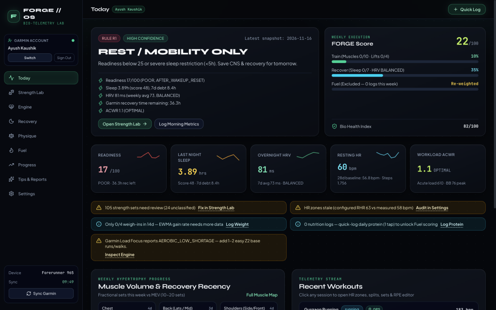
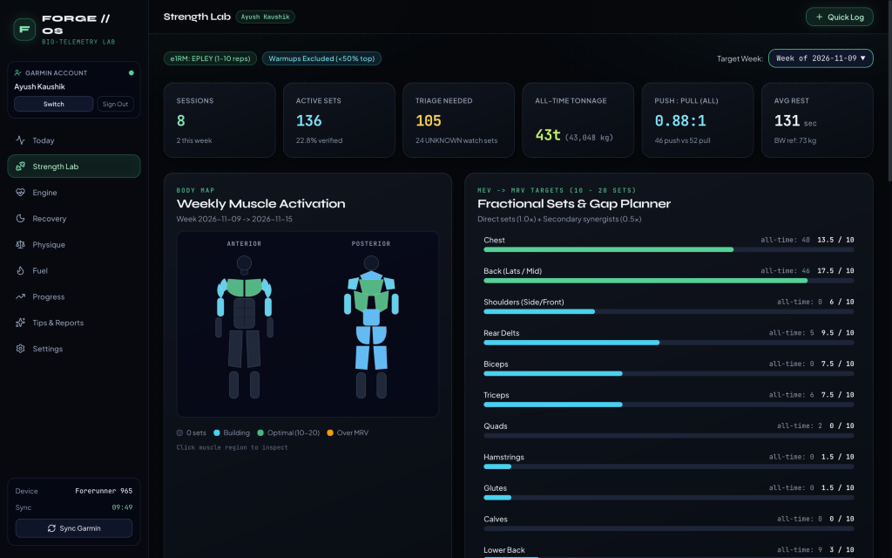
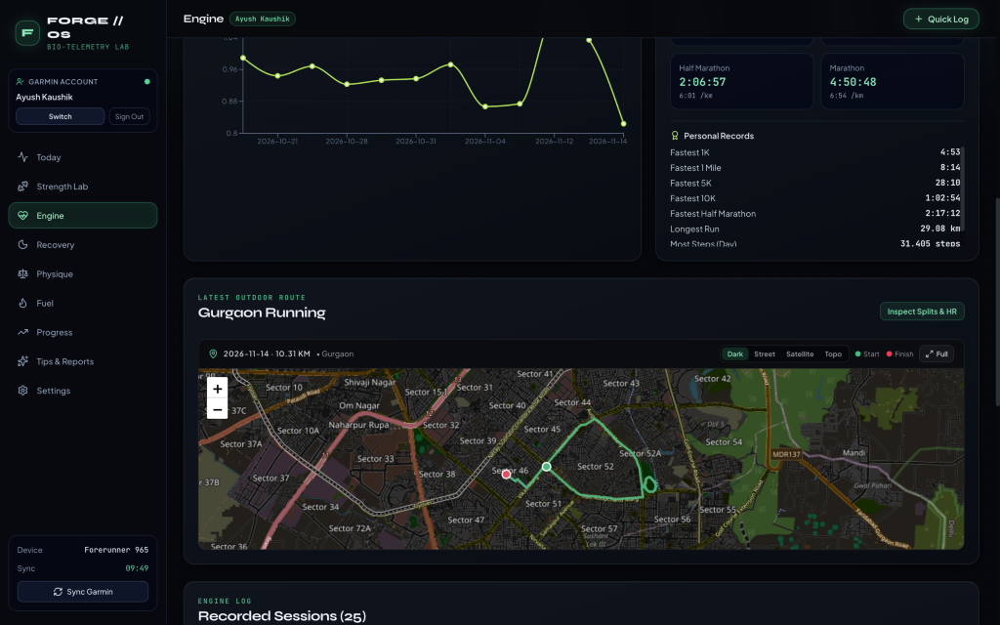
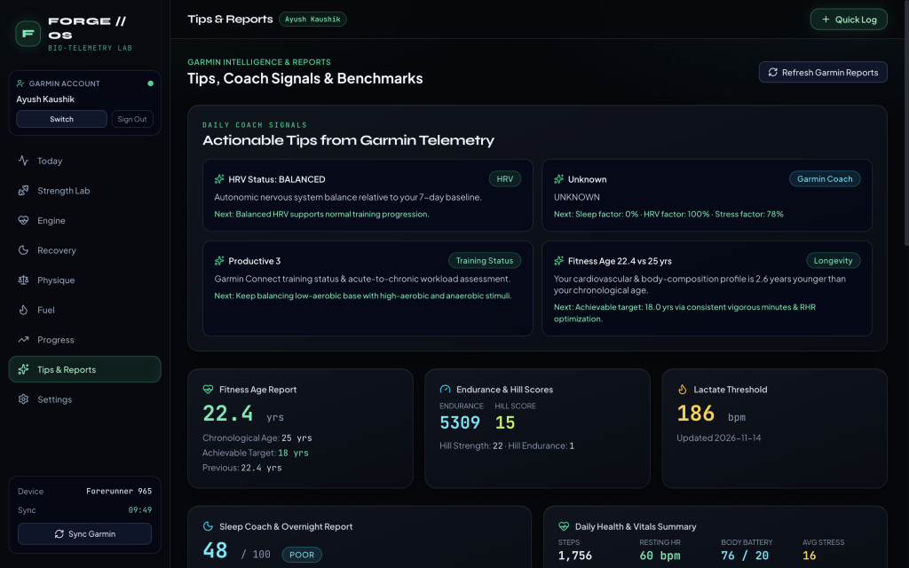

# FORGE — Garmin Bio-Telemetry & Hypertrophy Dashboard

A full-stack performance, recovery, strength, and nutrition dashboard built on **Garmin Connect** APIs using **Starlette + SQLite** (backend) and **React + TypeScript + Vite + Tailwind + Leaflet** (frontend).

---

## Features

- **Today (`/`)**: Daily FORGE Readiness & Score, Sleep/HRV/RHR/Body Battery/ACWR vitals, and recent workouts with GPS indicators.
- **Strength Lab (`/strength`)**: Weekly muscle-group set volume, anatomical muscle map, e1RM tracking, and Garmin strength set inspection/editing.
- **Engine (`/engine`)**: Cardio workload, ACWR, pace/HR trends, **Latest Outdoor Route** interactive GPS map, and session log with `GPS` badges.
- **Recovery (`/recovery`)**: Sleep stages, HRV balance, resting HR baseline, and recovery time tracking.
- **Physique (`/body`)**: Weight EWMA trend, body composition, and physique progress tracking.
- **Fuel (`/fuel`)**: Calorie, protein, and hydration tracking.
- **Progress (`/progress`)**: Multi-week/month trend charts and volume progression.
- **Tips & Reports (`/tips`)**: Actionable daily coach tips from Garmin telemetry, Fitness Age report, Endurance & Hill scores, Lactate Threshold, Sleep Coach & Daily Health summaries, Race Predictions (5K/10K/HM/Marathon), Personal Records, and Earned Badges.
- **Interactive GPS Maps (`RouteMap`)**: Leaflet maps with **Dark**, **Street**, **Satellite**, and **Topo** views plus **Fullscreen** mode (`Esc` to exit) and Start/Finish markers.
- **Garmin Account Sign-In**: Connect and manage your own Garmin Connect account directly from the sidebar UI (OAuth tokens are stored locally in `~/.garminconnect`).

---

## Screenshots

### Today — Daily Readiness, FORGE Score & Bio-Telemetry


### Strength Lab — Anatomical Muscle Map & Weekly Volume


### Engine — Cardio Workload & Interactive GPS Route Map


### Tips & Reports — Garmin Coach Signals, Fitness Age, Sleep & Race Predictor


---

## Project Structure

```text
dashboard/
├── server.py               # Uvicorn/Starlette entrypoint (serves API + built frontend)
├── api/
│   ├── accounts.py         # Multi-account registry & isolated DB/token resolution
│   ├── analytics.py        # Readiness, strength, engine, recovery, body, fuel & tips analytics
│   ├── db.py               # SQLite schema & connection helpers
│   ├── exercise_taxonomy.py# Muscle-group mapping for strength sets
│   ├── garmin_sync.py      # Garmin Connect sync, caching & GPS route extraction
│   └── routes.py           # Starlette HTTP API routes
├── frontend/               # React + TypeScript + Vite + Tailwind + Leaflet SPA
│   ├── package.json
│   └── src/
│       ├── api/client.ts
│       ├── components/     # AppShell, RouteMap, ActivityDetailModal, QuickLogModal, etc.
│       ├── pages/          # Today, Strength, Engine, Recovery, Body, Fuel, Progress, Tips, Settings
│       └── types/forge.ts
├── mcp/                    # Garmin Connect MCP server (garmin-mcp)
└── tests/
    └── test_forge_backend.py
```

---

## Setup & Running

### 1. Backend Dependencies (Python 3.10+)

Install Python dependencies in your virtual environment (e.g. `starlette`, `uvicorn`, `garminconnect`, `pytest`):

```bash
python3 -m venv .venv
source .venv/bin/activate
pip install starlette uvicorn garminconnect pytest httpx
```

### 2. Frontend Build

```bash
cd frontend
npm install
npm run build
cd ..
```

### 3. Run the Server

```bash
python server.py
```

Open **http://127.0.0.1:8765** in your browser.

---

## Garmin Authentication

Sign in directly from the **Garmin Account** card in the left sidebar using your Garmin Connect email and password.

- **Token Directory:** `~/.garminconnect` (override with `GARMIN_TOKEN_DIR`)
- **Local Database:** `data/forge.db`

---

## Tests

```bash
pytest tests/ -v
```
